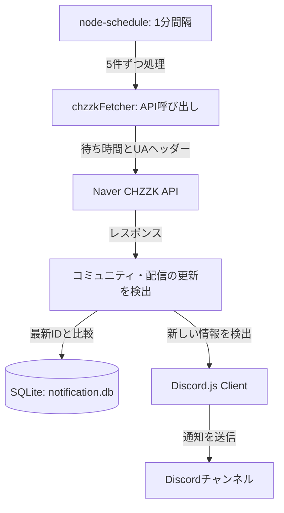

# CHZZK コミュニティ・配信通知 Discord ボット

CHZZK 配信者の**配信開始**や**新しいコミュニティ投稿**を、指定した Discord チャンネルへ通知するボットです。
単一インスタンス向けにサーバーリソースを抑え、ローカル環境から直接通信します。ランダムなリクエスト間隔（ジッター）とブラウザー形式のヘッダーを使用し、Naver API のレート制限を受けにくくします。

> [!WARNING]
> **⚠️ 小規模・個人利用向け（APIのレート制限に関する注意）**
> * セットアップを簡単にするため、複数プロキシへの分散リクエストと高可用性（HA）構成を省き、**単一のローカルインスタンスから直接通信**する構成です。
> * 1つのローカルIPアドレスからNaver APIへアクセスするため、多数の配信者（数十人以上）を登録して大規模な公開ボットとして運用すると、**リクエスト制限や通知の遅延が発生し、ボットが停止する可能性があります。**
> * 個人のDiscordサーバー、または少人数のサーバーで運用する**セルフホスト型ボット**としての利用を推奨します。

---

## ⚡ 公開ボットをすぐに利用する

サーバーのホスティング、開発者トークンの発行、データベースの設定をせずに**すぐボットを利用したい場合**は、24時間稼働中の公開通知ボットをDiscordサーバーに招待できます。

> [!NOTE]
> **💡 公開通知ボットについて**
> * このGitHub版（単一ノードからの直接通信）とは異なり、**公開ボットは高可用性（HA）構成と、各国に分散したプロキシノードを利用してNaver APIへアクセスします。**
> * 公開ボットの仕様や利用条件については、以下の公式ガイドをご確認ください。

* **公開ボットのガイド**: [CHZZK通知ボット公式ガイド](https://azestkingscrown.cloud/chzzk-bot-guide)
* **公開ボットの招待**: [Discordボットを招待](https://discord.com/discovery/applications/1491633594014236805)
* **お問い合わせ**: [不具合報告・匿名問い合わせ用Discord](https://discord.gg/5kGXA7TqeC)

> [!TIP]
> サーバー費用やパッケージ更新を管理せずに利用したい場合は、上記の公開ボットをご利用ください。

---

## 🚀 主な特徴

1. **軽量なSQLiteデータベース管理**
   - JSONファイルの代わりにSQLite 3を使用し、チャンネルごとの配信者登録情報を管理します。
2. **効率的なローカル直接通信（`chzzkFetcher.js`）**
   - 複数のDiscordチャンネルが同じ配信者を登録していても、配信者ごとのNaver API呼び出しを最大1分に1回に抑えます。
   - ブラウザー形式のヘッダーと0.1～0.3秒のランダムな待ち時間を使用し、アクセス制限のリスクを軽減します。
3. **スラッシュコマンドの登録に対応**
   - スクリプトからDiscord APIへコマンドを登録できます。
4. **ARM64に対応**
   - Linux、macOS、Windowsなどの環境で動作します。

---

## 🛠️ 動作の仕組み



1. **スケジューラー**: 1分ごとにデータベースから配信者を取得し、APIへの負荷を抑えるため5件ずつ並列に確認します。
2. **API呼び出し**: `chzzkFetcher`がNaverサーバーへ直接リクエストを送信します。
3. **更新の通知**: コミュニティ投稿IDや配信IDがデータベースの記録より新しい場合、登録先のDiscordチャンネルに通知し、データベースを更新します。

---

## 📦 インストールと起動

### 1. 必要な環境
- Node.js（v18以上を推奨）
- npm (Node Package Manager)

### 2. 依存パッケージのインストール
プロジェクトのルートフォルダーで次のコマンドを実行します。
```bash
npm install
```

### 3. 設定ファイルの作成（`config.json`）
テンプレート `config.template.json` をコピーして `config.json` を作成し、環境に合わせて各値を設定します。
```bash
cp config.template.json config.json
```

**設定項目**:
```json
{
   "token": "YOUR_DISCORD_BOT_TOKEN",         // Discord Developer Portalで発行したボットトークン
   "clientId": "YOUR_CLIENT_ID",               // DiscordアプリケーションID
   "guildId": "YOUR_GUILD_ID",                 // テストまたはコマンド登録先のDiscordサーバーID
   "channelId": "YOUR_DEFAULT_CHANNEL_ID",     // 通知先のデフォルトチャンネルID
   "ownerId": "YOUR_DISCORD_USER_ID",          // 管理コマンドの認証に使うボット所有者のユーザーID
  "api": {
    "community": "https://apis.naver.com/nng_main/nng_comment_api/v1/type/CHANNEL_POST/id/{streamerId}/comments?limit=10&offset=0&orderType=DESC&pagingType=PAGE",
    "live": "https://api.chzzk.naver.com/service/v2/channels/{streamerId}/live-detail",
    "channel": "https://api.chzzk.naver.com/service/v1/channels/{streamerId}",
    "search": "https://api.chzzk.naver.com/service/v1/search/channels?keyword={keyword}&size=1"
  }
}
```

### 4. スラッシュコマンドの登録
初回起動前に、次のコマンドでDiscordへスラッシュコマンドを登録してください。
```bash
node deploy-commands.js
```

### 5. ボットの起動
```bash
npm start
```

サーバー上でバックグラウンド実行する場合は、プロセス管理ツール `pm2` の利用を推奨します。
```bash
# Install pm2 globally if it is not installed.
sudo npm install -g pm2

# Register and start the background process.
pm2 start index.js --name chzzk-bot

# Configure automatic startup after reboot.
pm2 save
pm2 startup
```

---

## 🎮 Discordコマンド

Discordのチャット欄でスラッシュ（`/`）を入力すると、次のコマンドを利用できます。配信者は**32文字の固有ID**または**名前**で指定できます。

| コマンド | オプション | 説明 |
| :--- | :--- | :--- |
| `/register` | `streamer`、`type`（任意） | 配信者をこのチャンネルの通知リストに登録します。 |
| `/delete` | `streamer` | このチャンネルの通知リストから配信者を削除します。 |
| `/list` | なし | このチャンネルに登録済みの配信者を表示します。 |
| `/set_notification` | `streamer`、`type`、`mention_role`（任意）、`message`（任意） | 通知の種類、メンション先、追加メッセージを設定します。 |
| `/help` | なし | コマンドの使い方を表示します。 |
| `/ping` | なし | ボット、システム、CHZZK APIの状態を確認します。 |
| `/set_api` | `type`、`url` | **ボット所有者専用**。CHZZK APIのURLを変更します。 |

### 🔍 配信者の検索方法
1. **IDで指定する**
   - 配信者ページのURL（`https://chzzk.naver.com/xxxxxxxxxxxxxxxxxxxxxxxxxxxxxxxx`）に含まれる32文字のIDを入力します。
   - ボットがチャンネル情報を取得して登録します。
2. **名前で検索する**
   - 配信者の名前を入力します。
   - ボットがNaverのチャンネル検索APIで検索し、最初に一致したチャンネルを登録します。

---

## 📄 データベースの移行
以前のバージョンでJSON設定ファイル（`notification.json`）を使用していた場合、起動時にSQLiteデータベース（`notification.db`）へ自動で移行します。移行後、元のファイルは `notification.json.bak` に名前を変更して保存します。

---

## 📝 Naver CHZZK API仕様

本プログラムは、Naver CHZZKのデータ取得に以下の4つのAPIエンドポイントを使用します。公開APIですが、リクエストヘッダーの設定と呼び出し頻度の調整が必要です。

### 1. チャンネル基本情報API
* **設定項目**: `api.channel`
* **URL**: `https://api.chzzk.naver.com/service/v1/channels/{streamerId}`
* **実装関数**: `utilItem.getChannelInfo(streamerId)` in `utils/util.js`
* **用途**: チャンネルの有効性を確認し、プロフィール画像とチャンネル名を取得します。
* **主なレスポンス項目**:
   - `code`: ステータスコード（成功時は `200`）
   - `content.channelName`: 配信者名
   - `content.channelImageUrl`: プロフィール画像のURL

### 2. 最新コミュニティ投稿API
* **設定項目**: `api.community`
* **URL**: `https://apis.naver.com/nng_main/nng_comment_api/v1/type/CHANNEL_POST/id/{streamerId}/comments?limit=10&offset=0&orderType=DESC&pagingType=PAGE`
* **実装関数**: `utilItem.getCommunityRecentlyInfo(streamerId)` in `utils/util.js`
* **追加ヘッダー**: `'Content-Type': 'application/xml'`
* **用途**: 最新の投稿を取得し、投稿IDを比較して新着投稿を判定します。
* **主なレスポンス項目**:
   - `code`: ステータスコード（成功時は `200`）
   - `content.comments.data[0]`: 最新の投稿
   - `content.comments.data[0].user.userNickname`: 投稿者名
   - `content.comments.data[0].comment.commentId`: 投稿ID
   - `content.comments.data[0].comment.content`: 投稿本文
   - `content.comments.data[0].comment.attaches[0].attachValue`: 添付画像データ

### 3. ライブ配信詳細API
* **設定項目**: `api.live`
* **URL**: `https://api.chzzk.naver.com/service/v2/channels/{streamerId}/live-detail`
* **実装関数**: `utilItem.getLiveInfo(streamerId)` in `utils/util.js`
* **用途**: 配信状態、タイトル、カテゴリ、サムネイルを取得して配信開始を通知します。
* **主なレスポンス項目**:
   - `code`: ステータスコード（成功時は `200`）
   - `content.status`: 配信状態（`OPEN`: 配信中、`CLOSE`: オフライン）
   - `content.liveId`: 配信セッションID
   - `content.liveTitle`: 配信タイトル
   - `content.liveCategoryValue`: 配信カテゴリ
   - `content.liveImageUrl`: 配信サムネイルURL
   - `content.channel.channelName`、`content.channel.channelImageUrl`: チャンネル名とプロフィール画像

### 4. チャンネル検索API
* **設定項目**: `api.search`
* **URL**: `https://api.chzzk.naver.com/service/v1/search/channels?keyword={keyword}&size=1`
* **実装関数**: `utilItem.searchStreamer(keyword)` in `utils/util.js`
* **用途**: 配信者IDが不明な場合に名前で検索し、チャンネルIDを取得します。
* **主なレスポンス項目**:
   - `code`: ステータスコード（成功時は `200`）
   - `content.data[0].channel.channelId`: 検索結果のチャンネルID
   - `content.data[0].channel.channelName`: 検索結果のチャンネル名
   - `content.data[0].channel.channelImageUrl`: チャンネルのプロフィール画像URL
